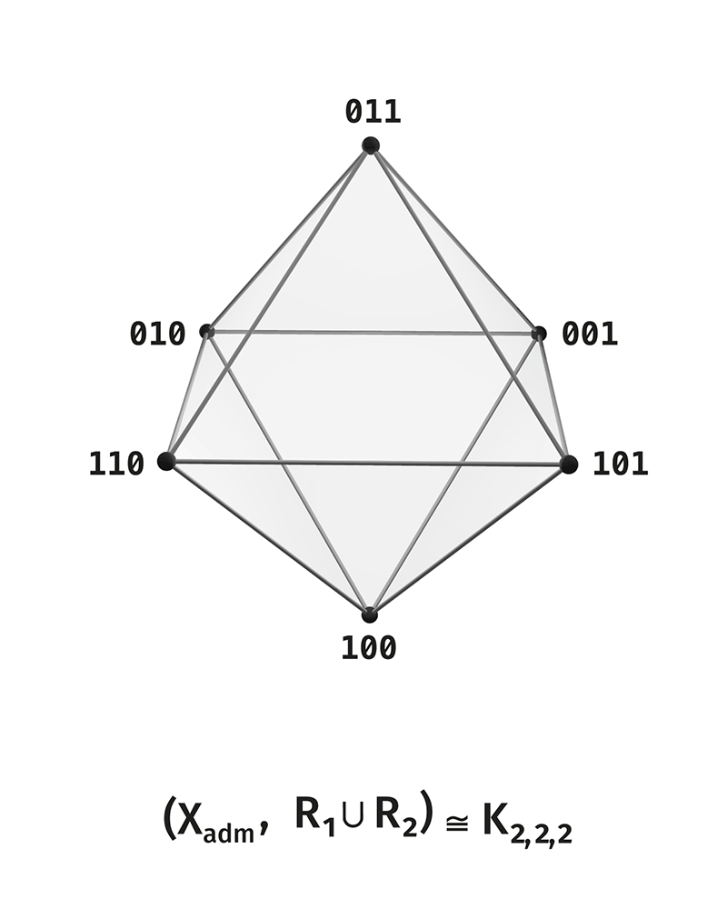
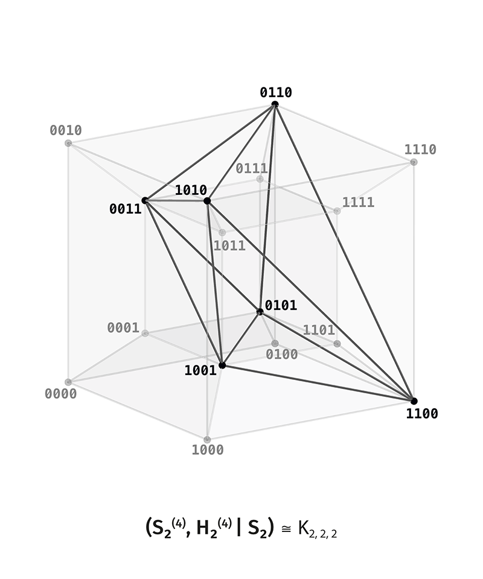

# DOT v3.3 — Distinction Observable Theory

> Neti, neti — not this, not this.
>
> — Yājñavalkya, *Bṛhadāraṇyaka Upaniṣad*

[](LICENSE-THEORY.md)
[](LICENSE)
[](https://doi.org/10.5281/zenodo.23481643)
[](https://doi.org/10.5281/zenodo.20059465)

**[Русская версия (README_RU.md)](README_RU.md)** · **Methodology v3.3:** [`00_Methodology/README.md`](00_Methodology/README.md) · **Book Concept DOI (all editions):** [10.5281/zenodo.23481643](https://doi.org/10.5281/zenodo.23481643) · **GitHub Release Concept DOI:** [10.5281/zenodo.20059465](https://doi.org/10.5281/zenodo.20059465)

**Distinction Observable Theory (DOT / ТНР)** is a deductive mathematical corpus with a combinatorial and operational core. The work rests on a single premise: **the act of distinction comes first, and objects arise as stable forms of held, presented, and recoverable distinction**.

Two sealed boxes both show a green signal. Pressing the same button leaves the first box green and turns the second red. The current reading does not separate them; a sequence of questions and admissible actions does ([`Chapter I.1`](00_Core/Book_I_EN/01_CHAPTER_I_01_OPERATIONAL_CONTRACT_QUESTION_AND_FOUR_STATE_SCENE_V3_3_EN.md)). DOT studies how such a distinction is drawn, retained through relations, recovered from a finite trace (continuation memory), carried across rank lifts, and connected to external problems without category mistakes (domain bridges).

The books pair analytical mathematical proofs with reproducible computational checks in `Julia` on explicitly constructed finite carriers, relations, and quotient maps. In canonical edition **`v3.3`**, every single-threaded trilogy verifier executes strictly in **exact integer, rational, and algebraic arithmetic (`0` floating-point types)**: the **`77/77`** gate count per language (`23` gates in Book I + `38` gates in Book II + `16` gates in Book III = **`154/154` bilingual gates**) certifies machine verification across each gate's stated finite domain alongside the analytical proof.

---

## Why Start with Distinction? Three Entry Points into Mathematics

Place a sphere, a right circular cylinder, and a right circular cone of the same diameter $D$ behind a screen and look at them strictly from above along their vertical axis. From above, three identical circles of diameter $D$ appear. Nothing in the solids themselves has changed: the answer depends on which question the chosen view poses. Add an orthogonal side view, and the three identical silhouettes separate into a circle, a rectangle, and an isosceles triangle.

Standard mathematical expositions often begin with a **ready-made object** (*"Let a set of points, a group, or a manifold be given…"*), leaving outside the problem statement how that object was singled out from the background, relative to what standard its features were read, and what trace is needed for comparison at the next step. Categorical and sheaf-theoretic methods in the twentieth century brought the **frame of reference and local medium** inside the formalism (category theory, local patchings and sheaves, slice categories).

**DOT compares these with a third way of posing the problem** — starting from the **minimal operational conditions of the act of distinction** before choosing a given object or coordinate grid:

1. **From a ready-made object.** The object and its elements are treated as already singled out before the problem begins. Initial question: *"What are the properties of this structure?"*
2. **From a frame of reference and ambient medium.** The object is given through a chosen viewpoint, standard, projection, or local medium. Initial question: *"How does the record transform under a change of base or chart?"*
3. **From distinction and the observer (DOT).** The initial question is posed earlier: *under what conditions is it possible at all to draw a distinction, retain its trace, and legitimately take the next step, and how do the mathematical languages of description grow sequentially out of these conditions?*

These three ways of posing a question are compatible and serve as a guide to the book rather than a classification of the history of mathematics. DOT retains the usual standards of mathematical proof and changes the order of exposition: as the operational questions posed to a scene grow more demanding, it determines **which mathematical structures suffice for the task at hand and which additional operational conditions force the passage to the next mathematical language**.

---

## Methodology of Edition `v3.3`: Two Constructive Engines

All `24` structural parts of the three-volume monograph (`Introduction E0` + `9` chapters of Book I + `9` chapters of Book II + `5` chapters of Book III; see [`00_Methodology/README.md`](00_Methodology/README.md)) unfold through a unified two-engine mechanism:

### Engine 1. Five-Beat Shift of the Observer Window ($\Pi_k \to \Pi_{k+1}$)
1. **External carrier vs. internal window ($\mathcal{O} \notin X$):** separate the external state carrier $X$ from the observer's accessible reading map $m_{\mathrm{acc}}\colon X \to B$.
2. **Explicit shadow witness:** exhibit a concrete pair of distinct states $(s, t) \in \ker m_{\mathrm{acc}}$ ($s \ne t$) that collapse under instantaneous reading.
3. **Splitting under admissible continuation:** exhibit an admissible step $T \in \mathcal{A}$ (or loop traversal) under which the pulled-back question $T^* q = q \circ T$ separates $s$ and $t$.
4. **Three-way check and finite counterexample:** establish the exact compatibility condition (forward, dual, and negative passes) accompanied by an explicit finite counterexample whenever any premise is dropped.
5. **Crystallization of the minimal invariant:** enlarge the window to $m'_{\mathrm{acc}} = (m_{\mathrm{acc}}, q \circ T)$ and pass to the minimal memory quotient $r_{\min}$ of the next tier.

### Engine 2. Three Solution-Count Regimes $|\mathcal{R}| \in \{1, >1, 0\}$
At every transition, the operational compatibility problem lands in one of three exact structural regimes:
- **$|\mathcal{R}| = 1$ (forced canonical invariant):** once the contract $\Gamma$ is fixed, the target quotient or rank is uniquely forced with zero free parameters (the minimal Moore–Nerode quotient, Ho–Kalman rank $d_{\min} = \operatorname{rank}\mathcal{H}_f$, the `SIC-POVM` threshold $\lambda = 1/\sqrt{3}$, exact mass conservation by the random-walk resolvent).
- **$|\mathcal{R}| > 1$ (gauge torsor of internal frames):** on the visible window there is a transitive family of equally valid internal coordinates or continuations (choice of reference decoder on a fiber, basis-change group $\mathrm{GL}_r(K)$, local gauge transformations $h_v \in G$, signed Fano cocycle, $\mathfrak{S}_m$-relabeling of hidden Markov states without a bilingual anchor).
- **$|\mathcal{R}| = 0$ (cohomological or diagonal obstruction):** no global solution exists in the current language ($\mathcal{S}_w(\mathcal{N}) = \varnothing$ when $[\kappa] \ne 0$ on the checkerboard octahedron $O_6$, non-splitting of $Q_8 \twoheadrightarrow V_4$ and $2O$, Peres–Mermin contextuality, Lawvere's diagonal fixed-point obstruction), strictly forcing the lift to the next mathematical tier.

---

## Distinction, Observer, and Rank Growth

In DOT, a **distinction** is a structurally held non-coincidence between positions. Formally, each finite representation is written as a quadruple $(X, R, q, \mathrm{rec})$, where $X$ is a finite carrier of positions, $R$ is a family of relations holding distinguishability on $X$, $q\colon X \to Y$ is a reading map, and $\mathrm{rec}$ is the recovery rule specifying what remains distinguishable after $q$. Reading an answer ($q\colon X \to Y$) and taking a state-transition step ($T\colon X \rightharpoonup X$) have distinct types and are never conflated; subjective experience (*qualia*) remains outside the axiomatics, while the typing rule $\mathcal{O} \notin X$ separates the current operational contract of observation from the elements of $X$.

Each new **rank** adds an independent binary coordinate to the cube $Q_n = \{0,1\}^n$, and removing the two homogeneous poles $0^n$ and $1^n$ isolates the active boundary carrier $U_n = Q_n \setminus \{0^n, 1^n\}$:

1. **Rank 1 (Minimal Polarity):** a two-sided cut $\{0, 1\}$ and polar exchange invariant under label renaming.
2. **Rank 2 (Four-State Scene $S_4 = Q_2$):** questions about the specimen $x \in \{0,1\}$ and reference $r \in \{0,1\}$ generate the square $S_4 = \{00, 01, 10, 11\}$, the comparison question $c = x \oplus r$, and invertible recovery $x = c \oplus r$.
3. **Rank 3 (First Complete Scene, $|U_3| = 6$):** the six non-constant balanced questions on $S_4$ unite polar opposition ($R_3 = 3K_2$), triadic splitting ($R_2 = K_3 \sqcup K_3$), and six-step Gray traversal ($R_1 = C_6$), forming the **octahedral shell** $K_{2,2,2} = O_6$:

<p align="center">
  <a href="assets/figures/4.1-R_12-octahedron.png">
    
  </a>
</p>

4. **Rank 4, the Fano Plane, and the Inter-Rank Law ($Q_n^* \cong U_{n+1} / \kappa_{n+1}$):** nonempty configurations of rank $n$ pass into antipodal axes of rank $n+1$. At **Rank 4** ($|U_4| = 14$), the middle weight-2 layer reproduces the six-vertex octahedron, while $U_4 / \kappa_4 \cong \mathbb{F}_2^3 \setminus \{000\}$ carries the incidence geometry of the **seven-point Fano projective plane** $\mathrm{PG}(2,2)$:

<p align="center">
  <a href="assets/figures/5.4-S2_rank4_octahedral_graph.png">
    
  </a>
</p>

From this finite core, the construction proceeds in stages:
- when opposite contributions must cancel without cyclic wrap-around, idempotent Boolean union gives way to **signed chains over $\mathbb{Z}$ and boundary and coboundary operators $\partial, \delta$**;
- when local windows agree pairwise on overlaps yet admit no global section, **cohomological gluing obstructions** arise ($H^1(\mathcal{N}(O_6);\mathbb{F}_2) \cong \mathbb{F}_2^3$ for the torsor sheaf $\mathcal{S}_w$ and the Peres–Mermin coboundary obstruction in the one-dimensional cokernel over $\mathbb{F}_2$);
- when hidden states return to the observation window after a delay, **Book II** introduces Ho–Kalman linear realization via Hankel matrices, dyadic continuation $\mathbb{Z}_2 \to \mathbb{R}/\mathbb{Z}$, the Cayley transform and dual numbers, spinor/central extensions of $W(B_3)$, octonions over $\mathbb{F}_2$ and Paige's simple Moufang loop of order `120`, the quantum Walsh–Bloch bridge, the `64` Hoggar lines, rational `SOS` certificates, and Lawvere's diagonal self-description limit;
- **Book III** establishes the two-arrow protocol $(\iota, \mathcal{O}_\pi)$ and the eight-row passport for **domain bridges** into external graph-theoretic, algebraic, philological, and algorithmic models: mass-conserving random-walk resolvents on directed weighted graphs, role-pair graphs of *Sāṃkhya*, *Yoga*, *Advaita*, and *Pāṇini*, prism rebuilding into the octahedron, oracle-free cofactor merging, and hidden Markov label-switching gauge orbits.

---

## Where to Start Reading

1. **Read the concise Methodological Guide (`00_Methodology`)**: [`README.md`](00_Methodology/README.md) / [`README_RU.md`](00_Methodology/README_RU.md).
2. **Open the Introductory Essay (`Introduction E0`)**:
   - **English:** [`00_INTRODUCTION_FROM_MATHEMATICAL_OBJECT_TO_DISTINCTION_AND_OBSERVER_V3_3_EN.md`](00_Core/Book_I_EN/00_INTRODUCTION_FROM_MATHEMATICAL_OBJECT_TO_DISTINCTION_AND_OBSERVER_V3_3_EN.md)
   - **Russian:** [`00_ВСТУПЛЕНИЕ_ОТ_МАТЕМАТИЧЕСКОГО_ОБЪЕКТА_К_РАЗЛИЧЕНИЮ_И_НАБЛЮДАТЕЛЮ_V3_3.md`](00_Core/Книга_I/00_ВСТУПЛЕНИЕ_ОТ_МАТЕМАТИЧЕСКОГО_ОБЪЕКТА_К_РАЗЛИЧЕНИЮ_И_НАБЛЮДАТЕЛЮ_V3_3.md)
3. **Move to `Chapter I.1`** ([EN](00_Core/Book_I_EN/01_CHAPTER_I_01_OPERATIONAL_CONTRACT_QUESTION_AND_FOUR_STATE_SCENE_V3_3_EN.md) / [RU](00_Core/Книга_I/01_ГЛАВА_I_01_ОПЕРАЦИОННЫЙ_ДОГОВОР_ВОПРОС_И_УСЛОВИЯ_ЧЕТЫРЁХМЕСТНОЙ_СЦЕНЫ_V3_3.md)), where the operational contract $\Gamma$ and the four-state scene $S_4$ are formally defined and verified.
4. **Keep at hand the Article-by-Article Registry of All 103 Statements** ([EN](00_Core/09_ARTICLE_BY_ARTICLE_REGISTRY_OF_103_STATEMENTS_EN.md) / [RU](00_Core/09_ПОСТАТЕЙНЫЙ_РЕЕСТР_103_ФОРМУЛИРОВОК.md)) with direct chapter-line links, epistemic statuses, and `Julia` gates.

---

## 1. Canonical Three-Volume Edition v3.3 (`00_Core/`, `103` Statements, `77/77` Julia Gates per Language)

The complete **Canonical Three-Volume Edition v3.3** is located in [`00_Core/`](00_Core/README.md) in **English (`Book_I_EN/`, `Book_II_EN/`, `Book_III_EN/`)** and **Russian (`Книга_I/`, `Книга_II/`, `Книга_III/`)**:

### Book I — Observer, Distinction, and the Finite Core
- **English Edition:** **[`00_Core/Book_I_EN/`](00_Core/Book_I_EN/)** · **[Single-File Full Volume (EN)](00_Core/01_BOOK_I_OBSERVER_DISTINCTION_AND_FINITE_CORE_V3_3_FULL_EN.md)** · **[Verifier (`23/23 GATES PASS`)](00_Core/Book_I_EN/11_verify_full_book_I_v3_3.jl)**
- **Russian Edition:** **[`00_Core/Книга_I/`](00_Core/Книга_I/)** · **[Single-File Full Volume (RU)](00_Core/01_КНИГА_I_НАБЛЮДАТЕЛЬ_РАЗЛИЧЕНИЕ_И_КОНЕЧНОЕ_ЯДРО_V3_3_ПОЛНЫЙ_ТОМ.md)** · **[Verifier (`23/23 GATES PASS`)](00_Core/Книга_I/11_verify_full_book_I_v3_3.jl)**
- **Scope (`Introduction E0`, `Chapters I.1–I.9`, `Appendices GR/VP/AD`, `57` numbered statements):**
  Operational contract of the observer, four-state scene $S_4 = \mathbb{F}_2^2$, and coupled observers via fibered products (`I.1`); partial actions in $\mathbf{Par}$, relation algebra $\mathbf{Rel}$, quantifier adjunction $\exists_R \dashv \forall_R$, and the Beck–Chevalley condition (`I.2`); Galois connection of distinguishability and minimal Moore–Myhill–Nerode state quotient (`I.3`); executor feedback, three-component operational cost ledger $(Z_D, Z_C, Z_F)$, and the $[6,3,3]_2$ shortened Hamming code on the octahedron (`I.4`); sign, antipodal complement, and exact cancellation over $\mathbb{Z}$ (`I.5`); graph readings on $O_6$ ($C_6, K_3 \sqcup K_3, 3K_2, K_{2,2,2}$), the Fano plane $\mathrm{PG}(2,2)$ with automorphism group $\mathrm{GL}_3(\mathbb{F}_2)$ of order `168`, and square-root parity in $\mathfrak{S}_6$ vs. $\mathfrak{S}_8$ (`I.6`); additive and divisor lattices, equilibrium window $N \in \{10, 12, 14\}$, and Ljunggren's Diophantine square `121` (`I.7`); oracle-free finite observation windows, Kronecker Hankel rank completion, and `20` families of Total Collapse Primes (`I.8`); pairwise compatibility, gluing obstructions on the checkerboard octahedron $O_6$ (`Theorem I.9.3a`), and transition to Book II (`I.9`).

### Book II — Memory, Continuous Continuation, Gluing, and the Quantum Scene
- **English Edition:** **[`00_Core/Book_II_EN/`](00_Core/Book_II_EN/)** · **[Single-File Full Volume (EN)](00_Core/02_BOOK_II_MEMORY_CONTINUATION_GLUING_AND_QUANTUM_SCENE_V3_3_FULL_EN.md)** · **[Verifier (`38/38 GATES PASS`)](00_Core/Book_II_EN/11_verify_full_book_II_v3_3.jl)**
- **Russian Edition:** **[`00_Core/Книга_II/`](00_Core/Книга_II/)** · **[Single-File Full Volume (RU)](00_Core/02_КНИГА_II_ПАМЯТЬ_НЕПРЕРЫВНОЕ_ПРОДОЛЖЕНИЕ_СКЛЕЙКА_И_КВАНТОВАЯ_СЦЕНА_V3_3_ПОЛНЫЙ_ТОМ.md)** · **[Verifier (`38/38 GATES PASS`)](00_Core/Книга_II/11_verify_full_book_II_v3_3.jl)**
- **Scope (`Chapters II.1–II.9`, `Appendices OPER/Q/GR/VP/AD`, `31` numbered statements):**
  Linear observer and Ho–Kalman minimal realization via block Hankel rank (`II.1`); dyadic gluing $\mathbb{Z}_2 \to \mathbb{R}/\mathbb{Z}$, jets, the Cayley transform, and dual numbers $K[\varepsilon]/(\varepsilon^2)$ (`II.2`); simplicial boundary $\partial_1\partial_2 = 0$, parity presheaf $\mathcal{G}$, obstruction cohomology $H^1(\mathcal{N};\mathbb{F}_2) \cong \mathbb{F}_2^3$ of the torsor sheaf $\mathcal{S}_w$ on $O_6$, and $\mathbb{RP}^2$ torsion (`II.3`); loop monodromy, discrete connection, automorphism group $\mathrm{Aut}(O_6) \cong W(B_3)$ of order `48`, and non-split extensions $Q_8, 2O$ (`II.4`); Fano plane $\mathrm{PG}(2,\mathbb{F}_2)$, signed octonions, Paige's simple Moufang loop of order `120` ($64 + 56 = 120$, $36 + 84 = 120$), and `84` sedenion zero-divisor quartets (`II.5`); quantum Walsh–Bloch bridge ($16 \to 8 \to 2$ at threshold $\lambda = 1/\sqrt{3}$), Kraus channels, and branch closure $W_\infty$ (`II.6`); qubit `SIC-POVM` tetrahedron, `64` Hoggar lines in $\mathbb{C}^8$ (frame potential gap $\frac{7}{810} > 0$), and Peres–Mermin cohomological obstruction (`II.7`); Whitney forms, semi-discrete Cahn–Hilliard gradient flow, and exact rational `SOS` certificates on the $21$-dimensional Fano flag space ($84 + 1687 = 1771$) (`II.8`); Lawvere's diagonal fixed-point limit of self-description and synthesis of the nine canonical minimal-memory regimes (`II.9`).

### Book III — Domain Bridges, Verifications, and Program for the Next Step
- **English Edition:** **[`00_Core/Book_III_EN/`](00_Core/Book_III_EN/)** · **[Single-File Full Volume (EN)](00_Core/03_BOOK_III_DOMAIN_BRIDGES_VERIFICATIONS_AND_NEXT_STEP_V3_3_FULL_EN.md)** · **[Verifier (`16/16 GATES PASS`)](00_Core/Book_III_EN/07_verify_full_book_III_v3_3.jl)**
- **Russian Edition:** **[`00_Core/Книга_III/`](00_Core/Книга_III/)** · **[Single-File Full Volume (RU)](00_Core/03_КНИГА_III_ПРЕДМЕТНЫЕ_МОСТЫ_ПРОВЕРКИ_И_ПРОГРАММА_СЛЕДУЮЩЕГО_ШАГА_V3_3_ПОЛНЫЙ_ТОМ.md)** · **[Verifier (`16/16 GATES PASS`)](00_Core/Книга_III/07_verify_full_book_III_v3_3.jl)**
- **Scope (`Chapters III.1–III.5`, `Appendices PM/GR/VP/AD`, `15` numbered statements):**
  Two-arrow domain bridge law $(\iota, \mathcal{O}_\pi)$, eight-row bridge passport, underdetermined polynomial and projector continuation, positive benchmarks ($6$-vertex unit-bridge graph resolvent and $D_{10}$-equivariant Whitney–Hodge isometry on $M_5$), and rejected benchmark ($P_7 \not\cong \mathrm{PG}(2,2)$) (`III.1`); directed weighted graphs, overlapping vertex-role reconciliation under changes of $\mathrm{Dom}(q)$, and mass-conserving random-walk resolvents vs. hard edge thresholding (`DB-01`, `III.2`); role-pair graphs of *Sāṃkhya*, *Yoga*, *Advaita*, and *Pāṇini* (`DB-02, DB-03`: self-dual mirror code $C = C^\perp$, duality of $\mathrm{KG}(5,2)$ and $J(5,2) = L(K_5)$, Möbius strip intertwining $M_5$, kāraka circulant $C_6(1,2) \cong O_6$, and generation of $\mathrm{End}(V_-) \cong M_3(\mathbb{R})$) (`III.3`); rebuilding the prism $\Pi_6$ into $O_6$, oracle-free large-prime cofactor merging via Kirchhoff's cyclomatic rank $r_{\mathrm{cyc}} = |E| - |V| + c$, and $\mathfrak{S}_m$ label-switching unidentifiability of hidden Markov states without a bilingual anchor (`DB-04, DB-05`, `III.4`); $O(|X|\cdot|\Sigma|)$ morphism-certificate verification protocol, discrete Grönwall lemma, and synthesis panorama of all `24` structural parts of the trilogy (`III.5`).

---

## Two-Part Attribution Standard and Five Epistemic Statuses (`103` Statements)

Edition `v3.3` eliminates all single-letter internal bracket codes: directly beneath the heading of every one of the `103` formal statements in the main text, an italicized two-part attribution note `*Classical foundation.* ... *Contribution of this book:* ...` cites the classical primary sources and states the exact operational role in the book, while Appendices `VP` and the master registry [`09_ARTICLE_BY_ARTICLE_REGISTRY_OF_103_STATEMENTS_EN.md`](00_Core/09_ARTICLE_BY_ARTICLE_REGISTRY_OF_103_STATEMENTS_EN.md) classify all `103` statements across five explicit verbal statuses:

1. **`Classical result in operational notation`** (`26` statements) — a classical theorem written in the notation of contract $\Gamma$ with primary-source citation and finite-window verification.
2. **`Extension of a classical theorem within contract Γ`** (`40` statements) — a classical core equipped with a newly proved condition inside contract $\Gamma$ (partial admissibility domains $\mathrm{Dom}(T_a), \mathrm{Dom}(q)$, shift threshold $j_0$, reading tolerance $\eta_{\mathrm{read}}$, cost ledger $(Z_D, Z_C, Z_F)$, or seam descent condition).
3. **`Original proved result of this book`** (`27` statements) — original theorems and exact finite classifications proved analytically in this book and verified by exhaustive enumeration in `Julia`.
4. **`Two-arrow structural correspondence (bridge)`** (`2` statements) — a two-arrow correspondence $(\iota, \mathcal{O}_\pi)$ in Book III satisfying the eight-row bridge passport and null/surrogate controls.
5. **`Proved prohibition / counterexample`** (`8` statements) — a rigorously proved obstruction, finite counterexample, or non-recoverability witness when a hypothesis is dropped.

---

## 2. Mathematical Supplement & Companion OEIS Repository

1. **In-Repository Supplement ([`02_Supplements/01_Hoggar_Fano_Octonions_Certificates`](02_Supplements/01_Hoggar_Fano_Octonions_Certificates/))** — **Hoggar Sign-Table Parity ($K_n$), Zorn Octonions $\mathrm{Oct}(\mathbb{F}_2)$, and `36` Fano Subgroups (`11/11` Julia Certificates)**:
   - Supplements `Book II (Chapters II.5 & II.7)` with the closed analytical Walsh–Hadamard parity formula $K_n = \frac{1}{4}\bigl(\frac{16^n + 4^n}{2} - 10^n\bigr)$ ($K_3 = 270$), constructive generation of all $12\,096$ automorphisms of $\mathrm{Aut}(\mathrm{Oct}(\mathbb{F}_2)) \cong G_2(2)$ verified across all $12\,096^2 = 146\,313\,216$ ordered pairs, and an explicit coordinate bijection between `36` Zorn idempotent pairs, `36` symplectic plus-forms, `36` maximal Fano/Levi subgroups $\mathrm{GL}_3(2) \subset \mathrm{PSU}_3(3)$, and `36` real Pauli structures.
2. **Companion Published Repository — [`Nondual-Observer/total-collapse-primes-oeis`](https://github.com/Nondual-Observer/total-collapse-primes-oeis)**:
   - Complete catalogue of `20` families of Total Collapse Primes over finite fields (accompanying `Book I, Chapter I.8, Proposition I.8.1`), including published sequence **[`OEIS A401173`](https://oeis.org/A401173)**, cards `00–19`, article, and standalone `Julia`/`C` verifiers.

---

## 3. Computational Verification (`01_Verification/`, Pure Julia 1.12+, `0` Floating-Point Types)

All canonical trilogy verifiers run on standard-library **Julia 1.12+** (`LinearAlgebra`, `Printf`, `SHA`, `Dates`, `Rational{BigInt}`) with zero external packages and zero floating-point types. Details: [`01_Verification/README.md`](01_Verification/README.md).

```bash
# Run all Canonical Trilogy v3.3 verifiers (77/77 Gates EN + 77/77 Gates RU + global link & hygiene audit)
julia --startup-file=no 01_Verification/run_all_trilogy_and_bridge_verifiers.jl

# Run including the 11-script Hoggar/Fano/Zorn certificate suite (--full)
julia --startup-file=no 01_Verification/run_all_trilogy_and_bridge_verifiers.jl --full
```

---

## Repository Structure

- **[`00_Methodology/`](00_Methodology/README.md)** — Methodological standard of edition `v3.3` (Five-Beat Shift of the Observer Window $\Pi_k \to \Pi_{k+1}$ and Solution-Count Trichotomy $|\mathcal{R}| \in \{1, >1, 0\}$).
- **[`00_Core/`](00_Core/README.md)** — Canonical Three-Volume Edition `v3.3` (`Books I–III` in `EN` & `RU`, `103` statements, `77/77` `Julia` gates per language = `154/154`).
- **[`01_Verification/`](01_Verification/README.md)** — Single-threaded `Julia 1.12+` master verification runner with global repository integrity checks.
- **[`02_Supplements/`](02_Supplements/README.md)** — Supplement `01_Hoggar_Fano_Octonions_Certificates` (parity $K_n$, $12\,096$ Zorn automorphisms & `36` Fano subgroups).
- **[`assets/figures/`](assets/figures/)** — Structural diagrams of Rank-3 and Rank-4 octahedral and projective scenes.

---

## Licenses

Theory texts, manuscripts, figures, and documentation are distributed under [CC BY-NC-SA 4.0](LICENSE-THEORY.md), unless a specific file states otherwise.

Executable source code (`.jl`) is distributed under the [Apache License 2.0](LICENSE).

---

<a id="support"></a>

## Supporting the Research

Support for this independent, open research project helps:

- conduct larger computational experiments;
- develop theoretical formalization;
- create reproducible research tools;
- publish “For Dummies: How to Prompt an AGI”.

| Currency | Network | Address |
|---|---|---|
| Bitcoin | BTC | `bc1qlaxsrum7fxpml57nsrtkjfkkxl5v3xtj4d0uxe` |
| USDT | TRC20 | `TM8U2EqVaT3tjvG6NyuKTqY4F5qc2A69Sy` |
| Ethereum | ETH | `0x4fFc68f0d55d19Fa5EBd5f6570a41E100aFe4a98` |

---

© 2026 Igor M. Zhuk. Theory and documentation are distributed under the corresponding licenses listed above.
