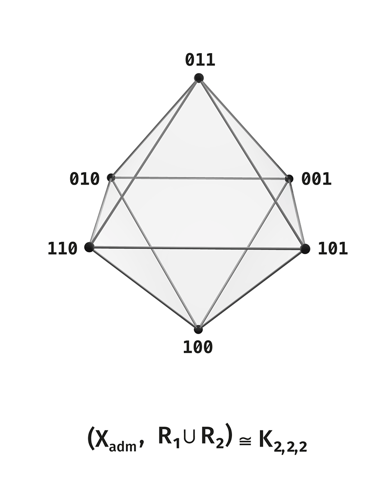
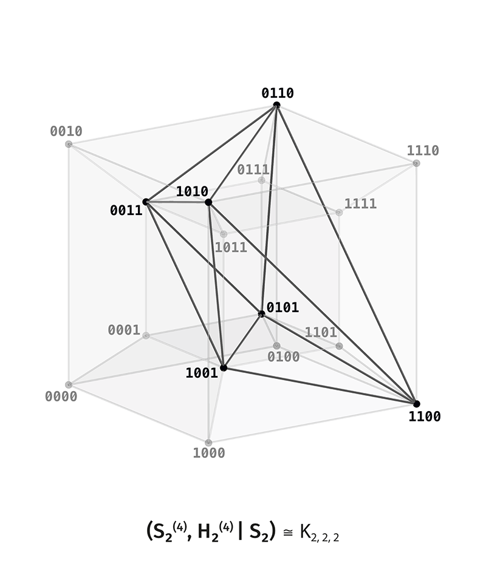

# DOT v3.3 — Теория Наблюдаемого Различения (Distinction Observable Theory)

> Нети, нети — не то, не то.
>
> — Яджнявалкья, *Брихадараньяка-упанишада*

[](LICENSE-THEORY.md)
[](LICENSE)
[](https://doi.org/10.5281/zenodo.23481643)
[](https://doi.org/10.5281/zenodo.20059465)

**[English version (README.md)](README.md)** · **Методология v3.3:** [`00_Methodology/README_RU.md`](00_Methodology/README_RU.md) · **Concept DOI книги (все редакции):** [10.5281/zenodo.23481643](https://doi.org/10.5281/zenodo.23481643) · **Concept DOI релизов GitHub:** [10.5281/zenodo.20059465](https://doi.org/10.5281/zenodo.20059465)

**Теория Наблюдаемого Различения (ТНР / DOT)** — дедуктивный математический корпус с комбинаторным и операционным ядром. В основе теории лежит одно положение: **первичен сам акт различения, а объекты возникают как устойчивые формы удержанного, предъявленного и восстановимого различения**.

Две опечатанные коробки показывают одинаковый зелёный сигнал. После нажатия одной и той же кнопки первая коробка остаётся зелёной, а вторая переключается на красный. Текущее показание их не разделяет; последовательность вопросов и допустимых действий — разделяет ([`Глава I.1`](00_Core/Книга_I/01_ГЛАВА_I_01_ОПЕРАЦИОННЫЙ_ДОГОВОР_ВОПРОС_И_УСЛОВИЯ_ЧЕТЫРЁХМЕСТНОЙ_СЦЕНЫ_V3_3.md)). ТНР исследует, как провести такое различение, удержать его отношениями, восстановить по конечному следу (память продолжения), перенести при подъёме ранга и без категориальных подмен связать с внешними задачами (предметные мосты).

В книгах приведены аналитические математические доказательства и воспроизводимые вычислительные проверки на языке `Julia` по явно построенным конечным носителям, отношениям и фактор-отображениям. В каноническом издании **`v3.3`** все однопоточные верификаторы работают исключительно в **точной целочисленной, рациональной и алгебраической арифметике (`0` типов с плавающей точкой)**: счётчик **`77/77`** на каждом языке (`23` гейта Книги I + `38` гейтов Книги II + `16` гейтов Книги III = **`154/154` двуязычных гейта**) фиксирует машинную проверку в заявленной конечной области в дополнение к аналитическому доказательству.

---

## Зачем начинать с различения? Три точки входа в математику

Поставьте за ширмой шар, прямой круговой цилиндр и прямой круговой конус одинакового диаметра $D$ и посмотрите на них строго сверху вдоль вертикальной оси. Сверху видны три одинаковых круга диаметра $D$. В самих телах ничего не изменилось: ответ зависит от того, какой вопрос задаёт выбранный вид. Добавьте боковой вид под прямым углом, и три одинаковых силуэта разойдутся на круг, прямоугольник и равнобедренный треугольник.

В учебных и классических изложениях задачу часто начинают с **готового объекта** (*«Пусть дано множество точек, группа или многообразие…»*), оставляя за рамками постановки способ выделения этого объекта из фона, выбор эталона для чтения признаков и состав следа, нужного для сличения на следующем шаге. Категорный и пучковый языки XX века ввели внутрь формализма **систему отсчёта и локальную среду** (теория категорий, локальные склейки и пучки, категории над базой).

**ТНР сопоставляет с ними третий способ постановки вопроса** — она начинает с **минимальных операционных условий самого акта различения** до выбора готового объекта или координатной сетки:

1. **От готового объекта.** Объект и его элементы считаются уже выделенными до начала постановки задачи. Исходный вопрос: *«Каковы свойства данной структуры?»*
2. **От системы отсчёта и среды.** Объект задаётся через выбранную точку обзора, эталон, проекцию или локальную среду. Исходный вопрос: *«Как преобразуется запись при смене базы или карты?»*
3. **От различения и наблюдателя (ТНР).** Исходный вопрос ставится раньше: *при каких условиях вообще возможно провести различение, сохранить его след и законно сделать следующий шаг, и как из этих условий последовательно вырастают сами языки описания?*

Эти три способа постановки вопроса совместимы и служат схемой чтения книги, а не классификацией всей истории математики. ТНР сохраняет обычные требования математического доказательства и меняет порядок изложения: по мере усложнения операционных вопросов к сцене она выясняет, **каких математических структур достаточно для текущей задачи и какие дополнительные операционные условия вынуждают переходить к следующему математическому языку**.

---

## Методология издания `v3.3`: два сквозных конструктивных двигателя

Все `24` структурные части трёхтомника (`Вступление E0` + `9` глав Книги I + `9` глав Книги II + `5` глав Книги III; см. [`00_Methodology/README_RU.md`](00_Methodology/README_RU.md)) развёртываются одним и тем же конструктивным механизмом из двух двигателей:

### Двигатель 1. Пятитактный сдвиг окна наблюдателя ($\Pi_k \to \Pi_{k+1}$)
1. **Разделение внешнего носителя и внутреннего окна ($\mathcal{O} \notin X$):** чётко разводятся внешний носитель состояний $X$ и доступное наблюдателю внутреннее отображение чтения $m_{\mathrm{acc}}\colon X \to B$.
2. **Явный теневой свидетель:** предъявляется конкретная пара несовпадающих положений $(s, t) \in \ker m_{\mathrm{acc}}$ ($s \ne t$), слипшаяся для мгновенного чтения.
3. **Расщепление допустимым продолжением:** указывается допустимый шаг $T \in \mathcal{A}$ (или петля обхода), после которого перенесённый вопрос $T^* q = q \circ T$ разделяет $s$ и $t$.
4. **Тройная проверка и конечный контрпример:** устанавливается точное условие совместности (прямой, встречный и отрицательный проход) с явным конечным контрпримером при снятии любой из посылок.
5. **Кристаллизация минимального инварианта:** окно расширяется до $m'_{\mathrm{acc}} = (m_{\mathrm{acc}}, q \circ T)$, выделяя минимальный фактор памяти $r_{\min}$ следующего ранга.

### Двигатель 2. Три режима мощности множества решений $|\mathcal{R}| \in \{1, >1, 0\}$
На каждом переходе операционная задача согласования приводит ровно к одному из трёх структурных исходов:
- **$|\mathcal{R}| = 1$ (вынужденный канонический инвариант):** при зафиксированном договоре $\Gamma$ искомый фактор или ранг определяется однозначно без свободных параметров (минимальный фактор Мура — Нероде, ранг Хо — Калмана $d_{\min} = \operatorname{rank}\mathcal{H}_f$, порог `SIC-POVM` $\lambda = 1/\sqrt{3}$, сохранение полной массы резольвентой случайного блуждания).
- **$|\mathcal{R}| > 1$ (торсор калибровочной свободы репера):** на видимом окне существует транзитивное семейство равноправных внутренних координат или продолжений (выбор опорного декодера на слое, группа замены базиса памяти $\mathrm{GL}_r(K)$, калибровочная смена локальных реперов $h_v \in G$, знаковая коцепь Фано, $\mathfrak{S}_m$-перестановка скрытых состояний без билингвы).
- **$|\mathcal{R}| = 0$ (когомологическое или диагональное препятствие):** глобального решения в текущем языке не существует ($\mathcal{S}_w(\mathcal{N}) = \varnothing$ при $[\kappa] \ne 0$ на шахматном октаэдре $O_6$, нерасщепимость центральных расширений $Q_8 \twoheadrightarrow V_4$ и $2O$, контекстуальность Переса — Мермина, диагональный запрет Ловера), что строго вынуждает подъём к следующему математическому языку.

---

## Различение, наблюдатель и рост рангов

Под **различением** в ТНР понимается структурно удерживаемое несовпадение положений. Формально каждое конечное представление записывается четвёркой $(X, R, q, \mathrm{rec})$, где $X$ — конечный носитель положений, $R$ — семейство отношений, удерживающих различимость на $X$, $q\colon X \to Y$ — отображение чтения, а $\mathrm{rec}$ — правило восстановления того, что остаётся различимым после $q$. Чтение ответа ($q\colon X \to Y$) и шаг изменения состояния ($T\colon X \rightharpoonup X$) имеют разные типы и никогда не смешиваются; субъективное переживание (*qualia*) остаётся за пределами аксиоматики, а правило $\mathcal{O} \notin X$ отделяет текущий операционный договор наблюдения от элементов носителя $X$.

Каждый новый **ранг** добавляет независимую двоичную координату к кубу $Q_n = \{0,1\}^n$, а отделение двух однородных полюсов $0^n$ и $1^n$ выделяет активный граничный носитель $U_n = Q_n \setminus \{0^n, 1^n\}$:

1. **Ранг 1 (Минимальная полярность):** двустороннее рассечение $\{0, 1\}$ и полярный обмен, инвариантный относительно переименования меток.
2. **Ранг 2 (Четырёхместная сцена $S_4 = Q_2$):** вопросы об образце $x \in \{0,1\}$ и эталоне $r \in \{0,1\}$ порождают квадрат $S_4 = \{00, 01, 10, 11\}$, производный вопрос сличения $c = x \oplus r$ и обратимый декодер $x = c \oplus r$.
3. **Ранг 3 (Первая полная сцена, $|U_3| = 6$):** шесть непостоянных уравновешенных вопросов на $S_4$ соединяют полярное противопоставление ($R_3 = 3K_2$), триадное расщепление ($R_2 = K_3 \sqcup K_3$) и шестишаговый обход Грея ($R_1 = C_6$), образуя **октаэдральную оболочку** $K_{2,2,2} = O_6$:

<p align="center">
  <a href="assets/figures/4.1-R_12-octahedron.png">
    
  </a>
</p>

4. **Ранг 4, плоскость Фано и межранговый закон ($Q_n^* \cong U_{n+1} / \kappa_{n+1}$):** непустые конфигурации текущего ранга переходят в антиподальные оси следующего. На **Ранге 4** ($|U_4| = 14$) средний слой веса 2 воспроизводит шестивершинный октаэдр, а фактор $U_4 / \kappa_4 \cong \mathbb{F}_2^3 \setminus \{000\}$ несёт инцидентность **семиточечной проективной плоскости Фано** $\mathrm{PG}(2,2)$:

<p align="center">
  <a href="assets/figures/5.4-S2_rank4_octahedral_graph.png">
    
  </a>
</p>

Из этого конечного ядра дальнейшее построение разворачивается по шагам:
- когда встречные вклады должны взаимно сокращаться без циклического переполнения, идемпотентное булево объединение сменяется **знаковыми цепями над $\mathbb{Z}$ и операторами границы и кограницы $\partial, \delta$**;
- когда локальные окна попарно согласованы на пересечениях, но не собираются в единое глобальное сечение, возникают **когомологические препятствия склейки** ($H^1(\mathcal{N}(O_6);\mathbb{F}_2) \cong \mathbb{F}_2^3$ для пучка-торсора $\mathcal{S}_w$ и кограничное препятствие Переса — Мермина в одномерном коядре над $\mathbb{F}_2$);
- когда скрытые состояния возвращаются в окно наблюдения с запаздыванием, **Книга II** вводит линейную реализацию Хо — Калмана по матрицам Ганкеля, диадическое продолжение $\mathbb{Z}_2 \to \mathbb{R}/\mathbb{Z}$, преобразование Кэли и дуальные числа, накрытия группы $W(B_3)$, октонионы над $\mathbb{F}_2$ и простую лупу Муфанг — Пейджа порядка `120`, квантовый мост Уолша — Блоха, `64` линии Хоггара, рациональные `SOS`-сертификаты и диагональный предел Ловера;
- **Книга III** задаёт двухстрелочный протокол $(\iota, \mathcal{O}_\pi)$ и восьмистрочный паспорт **предметных мостов** во внешние графовые, алгебраические, историко-филологические и алгоритмические задачи: консервативную резольвенту на взвешенных ориентированных графах, ролевые графы *Санкхьи*, *Йоги*, *Адвайты* и *Панини*, перестройку призмы в октаэдр, безоракульное слияние кофакторов и калибровочную орбиту перестановок скрытых марковских состояний.

---

## С чего начать чтение

1. **Прочитайте краткий методологический путеводитель (`00_Methodology`)**: [`README_RU.md`](00_Methodology/README_RU.md) / [`README.md`](00_Methodology/README.md).
2. **Откройте вводный очерк (`Вступление E0`)**:
   - **На русском:** [`00_ВСТУПЛЕНИЕ_ОТ_МАТЕМАТИЧЕСКОГО_ОБЪЕКТА_К_РАЗЛИЧЕНИЮ_И_НАБЛЮДАТЕЛЮ_V3_3.md`](00_Core/Книга_I/00_ВСТУПЛЕНИЕ_ОТ_МАТЕМАТИЧЕСКОГО_ОБЪЕКТА_К_РАЗЛИЧЕНИЮ_И_НАБЛЮДАТЕЛЮ_V3_3.md)
   - **На английском:** [`00_INTRODUCTION_FROM_MATHEMATICAL_OBJECT_TO_DISTINCTION_AND_OBSERVER_V3_3_EN.md`](00_Core/Book_I_EN/00_INTRODUCTION_FROM_MATHEMATICAL_OBJECT_TO_DISTINCTION_AND_OBSERVER_V3_3_EN.md)
3. **Перейдите к `Главе I.1`** ([RU](00_Core/Книга_I/01_ГЛАВА_I_01_ОПЕРАЦИОННЫЙ_ДОГОВОР_ВОПРОС_И_УСЛОВИЯ_ЧЕТЫРЁХМЕСТНОЙ_СЦЕНЫ_V3_3.md) / [EN](00_Core/Book_I_EN/01_CHAPTER_I_01_OPERATIONAL_CONTRACT_QUESTION_AND_FOUR_STATE_SCENE_V3_3_EN.md)), где вводится и проверяется операционный договор наблюдателя $\Gamma$ и четырёхместная сцена $S_4$.
4. **Держите под рукой постатейный реестр всех 103 формулировок** ([RU](00_Core/09_ПОСТАТЕЙНЫЙ_РЕЕСТР_103_ФОРМУЛИРОВОК.md) / [EN](00_Core/09_ARTICLE_BY_ARTICLE_REGISTRY_OF_103_STATEMENTS_EN.md)) с прямыми ссылками на строки глав, эпистемическими статусами и гейтами `Julia`.

---

## 1. Канонический Трёхтомник ТНР / DOT v3.3 (`00_Core/`, `103` формулировки, `77/77` гейтов Julia на каждом языке)

Полный **Канонический Трёхтомник v3.3** размещён в [`00_Core/`](00_Core/README_RU.md) на **русском (`Книга_I/`, `Книга_II/`, `Книга_III/`)** и **английском (`Book_I_EN/`, `Book_II_EN/`, `Book_III_EN/`)** языках:

### Книга I — Наблюдатель, различение и конечное ядро
- **Русское издание (RU):** **[`00_Core/Книга_I/`](00_Core/Книга_I/)** · **[Однофайловый полный том (RU)](00_Core/01_КНИГА_I_НАБЛЮДАТЕЛЬ_РАЗЛИЧЕНИЕ_И_КОНЕЧНОЕ_ЯДРО_V3_3_ПОЛНЫЙ_ТОМ.md)** · **[Верификатор (`23/23 GATES PASS`)](00_Core/Книга_I/11_verify_full_book_I_v3_3.jl)**
- **Английское издание (EN):** **[`00_Core/Book_I_EN/`](00_Core/Book_I_EN/)** · **[Single-File Full Volume (EN)](00_Core/01_BOOK_I_OBSERVER_DISTINCTION_AND_FINITE_CORE_V3_3_FULL_EN.md)** · **[Verifier (`23/23 GATES PASS`)](00_Core/Book_I_EN/11_verify_full_book_I_v3_3.jl)**
- **Содержание (`Вступление E0`, `Главы I.1–I.9`, `Приложения ГР/ВП/АД`, `57` нумерованных формулировок):**
  Операционный договор наблюдателя, четырёхместная сцена $S_4 = \mathbb{F}_2^2$ и сцепление наблюдателей через расслоённое произведение (`I.1`); частичные действия в $\mathbf{Par}$, алгебра отношений $\mathbf{Rel}$, сопряжение кванторов $\exists_R \dashv \forall_R$ и условие Бека — Шевалле (`I.2`); соответствие Галуа различимости и минимальный фактор-автомат Мура — Майхилла — Нероде (`I.3`); исполнитель, обратная связь, трёхкомпонентная смета $(Z_D, Z_C, Z_F)$ и укороченный код Хэмминга $[6,3,3]_2$ на октаэдре (`I.4`); знак, антиподальное дополнение и точное сокращение встречных шагов над $\mathbb{Z}$ (`I.5`); графовые структуры на $O_6$ ($C_6, K_3 \sqcup K_3, 3K_2, K_{2,2,2}$), проективная плоскость Фано $\mathrm{PG}(2,2)$ с группой $\mathrm{GL}_3(\mathbb{F}_2)$ порядка `168` и чётность квадратных корней в $\mathfrak{S}_6$ против $\mathfrak{S}_8$ (`I.6`); аддитивные и делительные решётки, окно равновесия $N \in \{10, 12, 14\}$ и диофантов квадрат Люнггрена `121` (`I.7`); безоракульные конечные окна наблюдения, ранг Ганкеля по Кронекеру и `20` семейств простых чисел полного схлопывания (`I.8`); попарная согласованность, препятствия склейки на шахматном октаэдре $O_6$ (`Теорема I.9.3а`) и переход к Книге II (`I.9`).

### Книга II — Память, непрерывное продолжение, склейка и квантовая сцена
- **Русское издание (RU):** **[`00_Core/Книга_II/`](00_Core/Книга_II/)** · **[Однофайловый полный том (RU)](00_Core/02_КНИГА_II_ПАМЯТЬ_НЕПРЕРЫВНОЕ_ПРОДОЛЖЕНИЕ_СКЛЕЙКА_И_КВАНТОВАЯ_СЦЕНА_V3_3_ПОЛНЫЙ_ТОМ.md)** · **[Верификатор (`38/38 GATES PASS`)](00_Core/Книга_II/11_verify_full_book_II_v3_3.jl)**
- **Английское издание (EN):** **[`00_Core/Book_II_EN/`](00_Core/Book_II_EN/)** · **[Single-File Full Volume (EN)](00_Core/02_BOOK_II_MEMORY_CONTINUATION_GLUING_AND_QUANTUM_SCENE_V3_3_FULL_EN.md)** · **[Verifier (`38/38 GATES PASS`)](00_Core/Book_II_EN/11_verify_full_book_II_v3_3.jl)**
- **Содержание (`Главы II.1–II.9`, `Приложения ОПЕР/КВ/ГР/ВП/АД`, `31` нумерованная формулировка):**
  Линейный наблюдатель и минимальная реализация памяти Хо — Калмана по рангу блочной матрицы Ганкеля (`II.1`); диадическая склейка $\mathbb{Z}_2 \to \mathbb{R}/\mathbb{Z}$, струи, преобразование Кэли и кольцо дуальных чисел $K[\varepsilon]/(\varepsilon^2)$ (`II.2`); симплициальная граница $\partial_1\partial_2 = 0$, предпучок чётности $\mathcal{G}$, когомологии препятствий $H^1(\mathcal{N};\mathbb{F}_2) \cong \mathbb{F}_2^3$ пучка-торсора $\mathcal{S}_w$ на $O_6$ и кручение $\mathbb{RP}^2$ (`II.3`); монодромия петли, дискретная связность, группа автоморфизмов $\mathrm{Aut}(O_6) \cong W(B_3)$ порядка `48` и нерасщепимые расширения $Q_8, 2O$ (`II.4`); плоскость Фано $\mathrm{PG}(2,\mathbb{F}_2)$, знаковые октонионы, простая лупа Муфанг — Пейджа порядка `120` ($64 + 56 = 120$, $36 + 84 = 120$) и `84` квартета делителей нуля седенионов (`II.5`); квантовый мост Уолша — Блоха ($16 \to 8 \to 2$ на пороге $\lambda = 1/\sqrt{3}$), каналы Крауса и ветвевое замыкание $W_\infty$ (`II.6`); тетраэдр `SIC-POVM` кубита, `64` линии Хоггара в $\mathbb{C}^8$ (зазор рамного потенциала $\frac{7}{810} > 0$) и когомологическое препятствие квадрата Переса — Мермина (`II.7`); формы Уитни, полудискретный поток Кана — Хиллиарда и точные рациональные `SOS`-сертификаты на $21$-мерном пространстве флагов Фано ($84 + 1687 = 1771$) (`II.8`); диагональная теорема Ловера о пределе полного самоописания и синтез девяти режимов минимальной памяти (`II.9`).

### Книга III — Предметные мосты, проверки и программа следующего шага
- **Русское издание (RU):** **[`00_Core/Книга_III/`](00_Core/Книга_III/)** · **[Однофайловый полный том (RU)](00_Core/03_КНИГА_III_ПРЕДМЕТНЫЕ_МОСТЫ_ПРОВЕРКИ_И_ПРОГРАММА_СЛЕДУЮЩЕГО_ШАГА_V3_3_ПОЛНЫЙ_ТОМ.md)** · **[Верификатор (`16/16 GATES PASS`)](00_Core/Книга_III/07_verify_full_book_III_v3_3.jl)**
- **Английское издание (EN):** **[`00_Core/Book_III_EN/`](00_Core/Book_III_EN/)** · **[Single-File Full Volume (EN)](00_Core/03_BOOK_III_DOMAIN_BRIDGES_VERIFICATIONS_AND_NEXT_STEP_V3_3_FULL_EN.md)** · **[Verifier (`16/16 GATES PASS`)](00_Core/Book_III_EN/07_verify_full_book_III_v3_3.jl)**
- **Содержание (`Главы III.1–III.5`, `Приложения ПМ/ГР/ВП/АД`, `15` нумерованных формулировок):**
  Двухстрелочный закон предметного моста $(\iota, \mathcal{O}_\pi)$, восьмистрочный паспорт, недоопределённость полиномиального и проекторного продолжения, эталоны положительного моста (резольвента на шестивершинном графе с единичным мостом и $D_{10}$-эквивариантная изометрия Уитни — Ходжа на $M_5$) и отвергнутый мост ($P_7 \not\cong \mathrm{PG}(2,2)$) (`III.1`); ориентированные взвешенные графы, сверка пересекающихся ролей при смене $\mathrm{Dom}(q)$ и сохраняющая массу резольвента случайного блуждания против порогового отсечения (`МП-01`, `III.2`); ролевые графы *Санкхьи*, *Йоги*, *Адвайты* и *Панини* (`МП-02, МП-03`: самодвойственный код зеркала $C = C^\perp$, двойственность $\mathrm{KG}(5,2)$ и $J(5,2) = L(K_5)$, сплетение с лентой Мёбиуса $M_5$, циркулянт караков $C_6(1,2) \cong O_6$ и порождение $\mathrm{End}(V_-) \cong M_3(\mathbb{R})$) (`III.3`); перестройка призмы $\Pi_6$ в октаэдр $O_6$, безоракульное слияние больших простых кофакторов через цикломатический ранг Кирхгофа $r_{\mathrm{cyc}} = |E| - |V| + c$ и $\mathfrak{S}_m$-неидентифицируемость скрытых марковских состояний без билингвы (`МП-04, МП-05`, `III.4`); протокол верификации сертификата морфизма за $O(|X|\cdot|\Sigma|)$, дискретная лемма Грёнвалля и сводная панорама всех `24` частей трилогии (`III.5`).

---

## Двухчастная атрибуция и пять эпистемических статусов (`103` формулировки)

В издании `v3.3` полностью исключены внутренние однобуквенные шифры: непосредственно под заголовком каждого из `103` утверждений в основном тексте приведена двухчастная курсивная справка `*Классическая основа.* ... *Вклад книги:* ...` с прямой ссылкой на классические первоисточники, а в Приложениях `ВП` и сводном реестре [`09_ПОСТАТЕЙНЫЙ_РЕЕСТР_103_ФОРМУЛИРОВОК.md`](00_Core/09_ПОСТАТЕЙНЫЙ_РЕЕСТР_103_ФОРМУЛИРОВОК.md) каждое утверждение отнесено к одному из пяти явных статусов:

1. **`Классический результат в операционной записи`** (`26` утв.) — классическая теорема в обозначениях договора $\Gamma$ со ссылкой на первоисточник и конечной проверкой.
2. **`Расширение классической теоремы в договоре Γ`** (`40` утв.) — классическое ядро с новым доказанным условием внутри договора $\Gamma$ (частичные области допуска $\mathrm{Dom}(T_a), \mathrm{Dom}(q)$, порог $j_0$, погрешность чтения $\eta_{\mathrm{read}}$, смета $(Z_D, Z_C, Z_F)$ или условие спуска на шве).
3. **`Собственный доказанный результат книги`** (`27` утв.) — собственные теоремы и точные конечные классификации книги, доказанные аналитически и перебором в `Julia`.
4. **`Двухстрелочное структурное соответствие (мост)`** (`2` утв.) — двухстрелочный мост $(\iota, \mathcal{O}_\pi)$ в Книге III с полным восьмистрочным паспортом и суррогатным контролем.
5. **`Доказанный запрет / контрпример`** (`8` утв.) — строго доказанный запрет, конечный контрпример или невосстановимость инварианта при снятии посылки.

---

## 2. Математическое дополнение и сопутствующий репозиторий OEIS

1. **Внутреннее дополнение ([`02_Supplements/01_Hoggar_Fano_Octonions_Certificates`](02_Supplements/01_Hoggar_Fano_Octonions_Certificates/))** — **Чётность таблицы знаков Хоггара ($K_n$), октонионы Цорна $\mathrm{Oct}(\mathbb{F}_2)$ и `36` подгрупп Фано (`11/11` сертификатов Julia)**:
   - Дополняет `Книгу II (Главы II.5 и II.7)` замкнутой аналитической формулой чётности Уолша — Адамара $K_n = \frac{1}{4}\bigl(\frac{16^n + 4^n}{2} - 10^n\bigr)$ ($K_3 = 270$), конструктивным построением всех $12\,096$ автоморфизмов $\mathrm{Aut}(\mathrm{Oct}(\mathbb{F}_2)) \cong G_2(2)$ с полной проверкой $12\,096^2 = 146\,313\,216$ композиций и явным координатным словарём между `36` парами идемпотентов Цорна, `36` симплектическими плюс-формами, `36` подгруппами Фано/Леви $\mathrm{GL}_3(2) \subset \mathrm{PSU}_3(3)$ и `36` вещественными структурами Паули.
2. **Опубликованный сопутствующий репозиторий — [`Nondual-Observer/total-collapse-primes-oeis`](https://github.com/Nondual-Observer/total-collapse-primes-oeis)**:
   - Полный каталог `20` семейств простых чисел полного схлопывания над конечными полями (к `Книге I, Глава I.8, Предложение I.8.1`), включая опубликованную последовательность **[`OEIS A401173`](https://oeis.org/A401173)**, карточки `00–19`, статью и автономные верификаторы на `Julia` и `C`.

---

## 3. Вычислительная проверка (`01_Verification/`, чистая Julia 1.12+, `0` типов с плавающей точкой)

Все верификаторы канонического трёхтомника работают на стандартной библиотеке **Julia 1.12+** (`LinearAlgebra`, `Printf`, `SHA`, `Dates`, `Rational{BigInt}`) без внешних пакетов и без арифметики с плавающей точкой. Подробности: [`01_Verification/README_RU.md`](01_Verification/README_RU.md).

```bash
# Единый запуск верификаторов Канонического Трёхтомника v3.3 (77/77 гейтов EN + 77/77 гейтов RU + глобальный аудит ссылок)
julia --startup-file=no 01_Verification/run_all_trilogy_and_bridge_verifiers.jl

# Полный запуск вместе с 11 сертификатами дополнения Хоггара/Фано/Цорна (--full)
julia --startup-file=no 01_Verification/run_all_trilogy_and_bridge_verifiers.jl --full
```

---

## Структура репозитория

- **[`00_Methodology/`](00_Methodology/README_RU.md)** — Методологический стандарт издания `v3.3` (пятитактный сдвиг окна наблюдателя $\Pi_k \to \Pi_{k+1}$ и трихотомия $|\mathcal{R}| \in \{1, >1, 0\}$).
- **[`00_Core/`](00_Core/README_RU.md)** — Канонический Трёхтомник `v3.3` (`Книги I–III` на `EN` и `RU`, `103` формулировки, `77/77` гейтов `Julia` на каждом языке = `154/154`).
- **[`01_Verification/`](01_Verification/README_RU.md)** — Единый однопоточный мастер-верификатор `Julia 1.12+` с глобальным аудитом целостности репозитория.
- **[`02_Supplements/`](02_Supplements/README_RU.md)** — Дополнение `01_Hoggar_Fano_Octonions_Certificates` (чётность $K_n$, $12\,096$ автоморфизмов Цорна и `36` подгрупп Фано).
- **[`assets/figures/`](assets/figures/)** — Структурные диаграммы октаэдральной и проективной сцен Рангов 3 и 4.

---

## Лицензии

Теоретические тексты, манускрипты, рисунки и документация распространяются под лицензией [CC BY-NC-SA 4.0](LICENSE-THEORY.md), если в конкретном файле не указано иное.

Исполняемый исходный код (`.jl`) распространяется под лицензией [Apache License 2.0](LICENSE).

---

<a id="поддержка"></a>

## Поддержка исследования

Проект развивается как **независимое открытое исследование**. Поддержка помогает:

- проводить более масштабные вычислительные эксперименты;
- развивать теоретическую формализацию;
- создавать воспроизводимые исследовательские инструменты;
- поддержать выпуск книги из серии «Руководство для чяйников: Как запромптить AGI».

Она также позволяет уделять исследованию больше времени и сохранять его независимость и открытый характер.

| Валюта | Сеть | Адрес |
|---|---|---|
| Bitcoin | BTC | `bc1qlaxsrum7fxpml57nsrtkjfkkxl5v3xtj4d0uxe` |
| USDT | TRC20 | `TM8U2EqVaT3tjvG6NyuKTqY4F5qc2A69Sy` |
| Ethereum | ETH | `0x4fFc68f0d55d19Fa5EBd5f6570a41E100aFe4a98` |

---

© 2026 Igor M. Zhuk (И. М. Жук). Теория и документация распространяются под соответствующими лицензиями, указанными выше.
